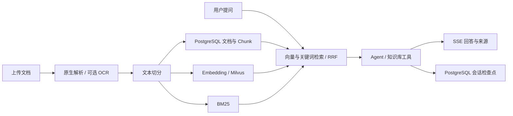

# Enterprise RAG Agent

这是我个人设计、开发与维护的企业知识库与 Agent 问答项目，围绕文档管理、混合检索、来源追溯和多轮对话构建完整应用。上传资料后完成解析、切分和索引；提问时结合向量检索与关键词检索返回相关片段，再生成带来源的回答。

作者与维护者：[SuperSgdk](https://github.com/SuperSgdk) · [保留所有权利](LICENSE)

## 功能

- 文档入库：Markdown、TXT、PDF、DOCX，支持纯文本快速入库。
- 文档解析：原生文本解析；可选扫描件 OCR。
- 三种切分策略：结构化、半结构化、非结构化。
- 文档与 Chunk 管理：查看、编辑、禁用、删除、重建索引。
- 混合检索：Milvus 向量检索 + BM25，使用 RRF 融合排序。
- Agent 问答：回答前检索，支持继续调用知识库工具；SSE 流式输出、来源展示和工具事件。
- 会话管理：历史记录与 PostgreSQL 持久化检查点。
- Vue 工作台：总览、入库、文档、Chunk、检索调试与对话页面。

## 一次请求怎么流转

## 技术栈

后端使用 Python、FastAPI、LangChain、LangGraph、SQLAlchemy；前端使用 Vue 3、TypeScript、Element Plus、Pinia、Vite。数据服务包括 PostgreSQL、Redis、Milvus、etcd、MinIO，可选 Attu 管理台。默认回答和向量模型使用 DashScope；OCR 使用可选的百度 PaddleOCR-VL。

## 查看与使用权限

本仓库用于展示我的个人项目及其实现，**不授予运行、部署、修改、再发布或商用等使用权**。商业和非商业用途均需先取得 [SuperSgdk](https://github.com/SuperSgdk) 的书面授权。完整条款见 [LICENSE](LICENSE)。

公开可见不等于获得使用授权。GitHub 平台条款规定的查看和站内 Fork 权限不受此声明限制；公开仓库也无法从技术上阻止下载。第三方依赖按各自许可证使用。

## 验证状态

维护者已在独立 Python 环境完成依赖安装，9 项离线测试通过；前端 TypeScript 检查和生产构建通过。GitHub Actions 的后端离线测试和前端安装、构建均已在 Linux 环境通过。

本次未重新调用真实模型或 OCR，也未启动完整数据库服务。离线测试和前端构建不能替代完整业务验收。具体证据及限制见 [验证记录](docs/validation.md)。

## 目录

| 目录 | 职责 |
| --- | --- |
| `backend/app/api/` | HTTP 接口与参数校验 |
| `backend/app/services/` | 文档、检索、会话与 OCR 业务 |
| `backend/app/rag/` | 解析、切分、入库、BM25 与混合检索 |
| `backend/app/agent/` | Agent、工具、运行上下文和检查点 |
| `backend/app/core/` | 模型、数据库、缓存与向量库连接 |
| `frontend/src/` | 管理工作台 |
| `deploy/` | 基础服务 Compose 与配置示例 |
| `scripts/` | 配置、安装、启停 |
| `tests/` | 离线测试和可选集成测试 |
| `demo_data/` | 虚构演示资料 |

## 使用边界

这是本地知识库应用，当前没有用户鉴权、多租户隔离、生产限流或完整数据库迁移流程。默认仅监听本机，不能直接暴露到公网。

公开仓库只保留配置字段、空白凭证和占位示例，不包含我的 API 密钥、私有模型接口地址、个人配置、数据库、实际上传资料或运行日志。模型厂商及通用模型名用于说明技术实现。真实运行参数由未跟踪的本地 `.env` 提供；演示资料均为虚构内容。

检索和模型回答可能遗漏或误读信息，应核对引用原文；已测样例不代表复杂表格、公式、所有 OCR 类型或大规模数据效果。第三方依赖按各自许可证使用。
